# Nct-MicroService 框架

## 项目概述

Nct-MicroService 是一个基于 .NET 8.0 开发的微服务框架，提供了完整的模块化架构、依赖注入、数据访问、身份认证、缓存、任务调度等核心功能。该框架旨在简化企业级应用的开发，提供一套完整的解决方案。

## 技术栈

### 后端技术
- **框架**: .NET 8.0
- **依赖注入**: Castle Windsor
- **ORM**: 自定义数据访问层
- **缓存**: Redis, 内存缓存
- **认证**: JWT
- **日志**: NLog
- **任务调度**: Quartz
- **实时通信**: SignalR
- **消息队列**: 自定义实现

### 前端技术
- **框架**: Vue.js 2.6
- **UI组件库**: Element UI
- **路由**: Vue Router
- **状态管理**: Vuex
- **图表库**: Highcharts
- **工作流设计**: LogicFlow

## 项目结构

```
src/
├── Framework/           # 核心框架
│   ├── Nct/             # 基础核心库
│   ├── Nct.AspNetCore/  # ASP.NET Core 集成
│   ├── Nct.DataAccess/  # 数据访问层
│   ├── Nct.Identity/    # 身份认证
│   ├── Nct.OAuth/       # OAuth 集成
│   ├── Nct.Scripting/   # 脚本支持
│   ├── Nct.SignalR/     # SignalR 集成
│   └── Nct.ApiJson/     # API JSON 支持
├── HostServices/        # 宿主服务
│   ├── CoreModule.Host/ # 核心模块宿主
│   ├── FlowModule.Host/ # 工作流模块宿主
│   ├── FormModule.Host/ # 表单模块宿主
│   └── Gateway.Host/    # 网关宿主
├── Modules/             # 业务模块
│   ├── Core/            # 核心业务模块
│   ├── Flow/            # 工作流模块
│   └── Form/            # 表单模块
└── Nct.UI/              # 前端项目
```

## 核心功能

### 1. 模块化架构
- 基于模块的插件式设计
- 模块间的依赖管理
- 统一的模块初始化和启动流程

### 2. 依赖注入
- 基于 Castle Windsor 的依赖注入容器
- 支持构造函数注入、属性注入
- 支持单例、瞬态等生命周期管理

### 3. 数据访问
- 自定义 ORM 实现
- 支持 SQL 构建和执行
- 支持事务管理

### 4. 身份认证与授权
- 基于 JWT 的身份认证
- 角色和权限管理
- 支持 OAuth 集成

### 5. 缓存系统
- 内存缓存实现
- Redis 缓存集成
- 统一的缓存接口

### 6. 任务调度
- 基于 Quartz 的任务调度
- 支持定时任务、周期性任务
- 任务执行日志

### 7. 事件总线
- 基于 MediatR 的事件处理
- 支持同步和异步事件

### 8. 实时通信
- 基于 SignalR 的实时通信
- 在线客户端管理
- 实时通知功能

### 9. API JSON
- 支持 JSON 格式的 API 定义
- 在线 API 文档生成

### 10. 前端框架
- 基于 Vue.js 的单页应用
- Element UI 组件库
- 工作流设计器
- 表单设计器

## 后台主要页面

### 1. 系统登录

管理端登录入口，提供账号、密码、图形算术验证码和记住密码选项。


### 2. 首页工作台

汇总待办任务、已办任务、我的申请和流程数量，并通过曲线图、柱状图展示近半个月的访问次数。

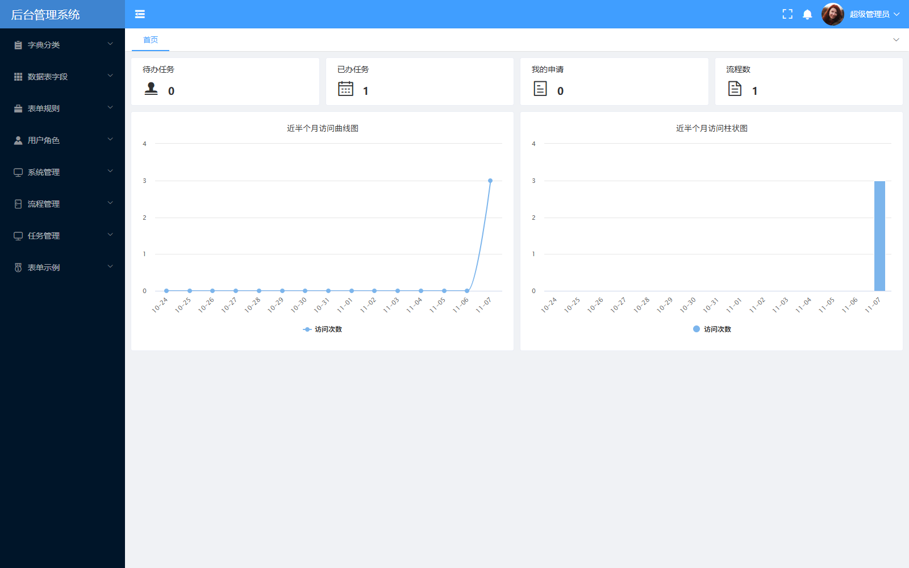

### 3. 用户管理

左侧部门树用于筛选用户，右侧列表展示用户名、姓名、所属部门、状态和登录时间，并提供查询及用户维护入口。

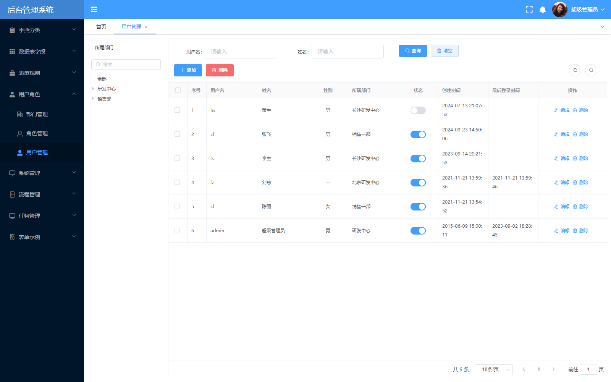

### 4. 角色管理

维护角色编号、角色名称及描述，展示开发人员、业务员、审核员和管理员等角色配置。

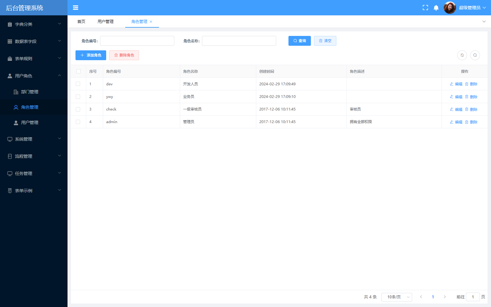

### 5. 菜单管理

以树形列表组织后台菜单，展示菜单编码、地址、启用状态、图标及排序，提供新增子项和编辑入口。

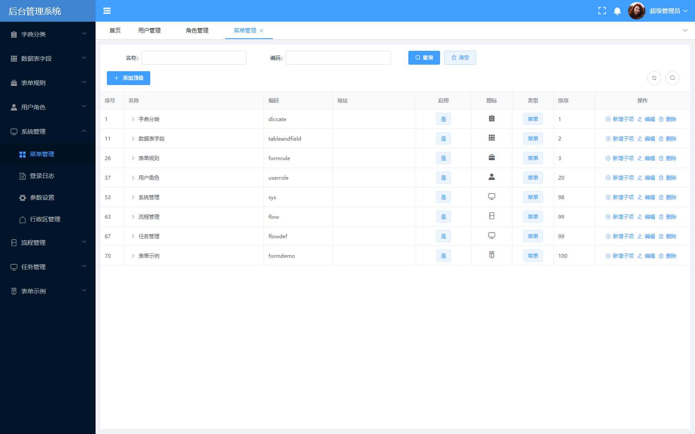

### 6. 流程列表

管理审批流程定义，按流程名称、编号查询；当前示例为“请假申请”流程。

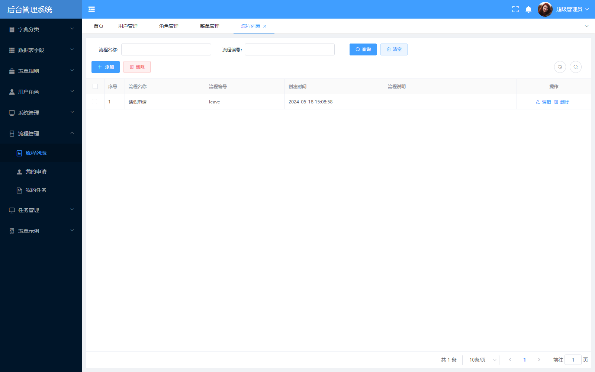

### 7. 审批流程设计器

通过可视化节点与连线配置审批路径。请假示例包含开始、领导审批、请假天数判断、人事主管审批、总经理审批和结束节点。

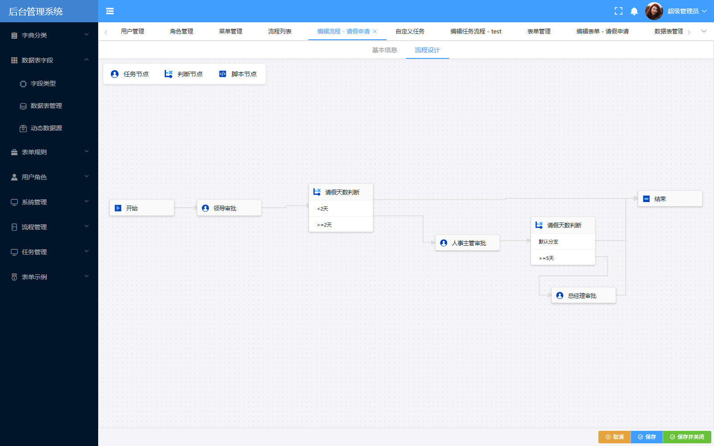

### 8. 自定义任务

集中展示任务类型、执行周期、启用状态、最后运行时间和结果，并提供流程配置与运行日志入口。

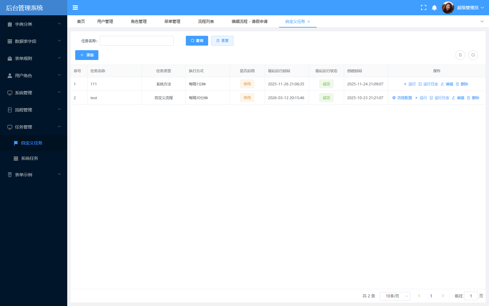

### 9. 任务流程设计器

以可视化方式编排自动化任务。当前示例展示 HTTP 请求、JSON 解析、AI 模型、条件判断、迭代和脚本节点。

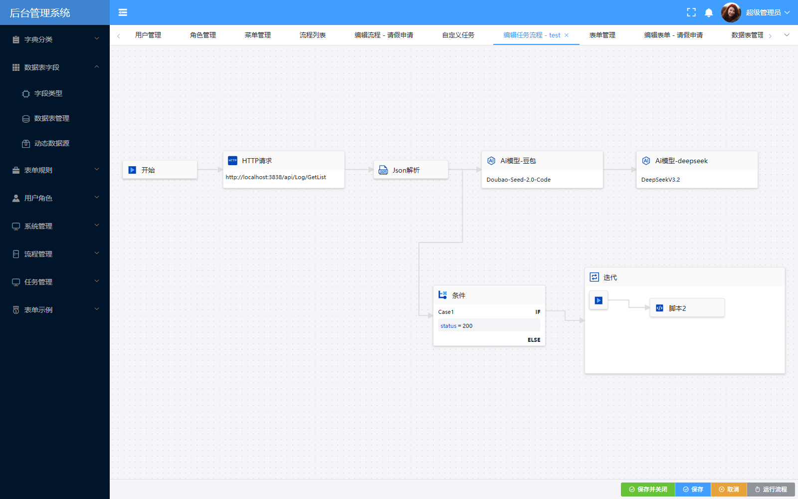

### 10. 表单管理

管理表单名称、编号和定义，示例包含请假申请、用户管理、教育经历、新闻表单和参数设置等。

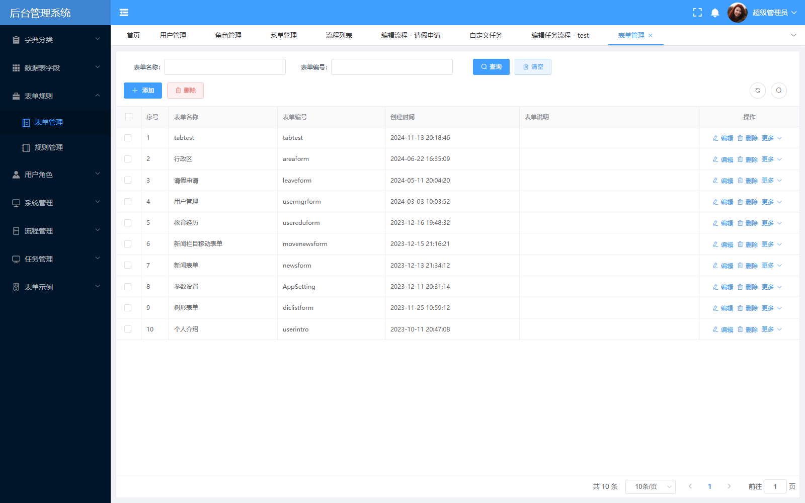

### 11. 表单设计器

左侧为控件面板，中间为表单布局，右侧配置控件字段、标题、可见性、必填及验证规则；同时提供列表视图、代码脚本和预览入口。

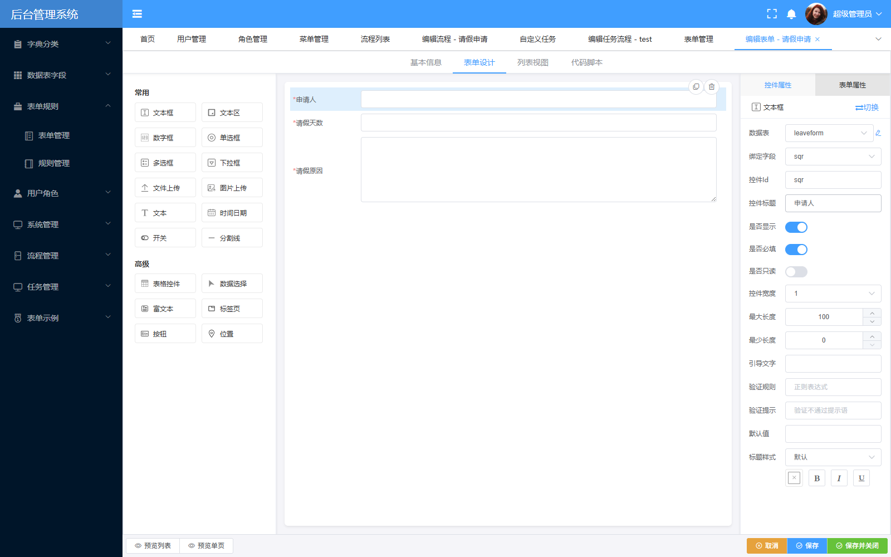

### 12. 数据表管理

维护表单关联的数据表，展示表名、描述和创建时间，提供编辑及导入现有表入口。

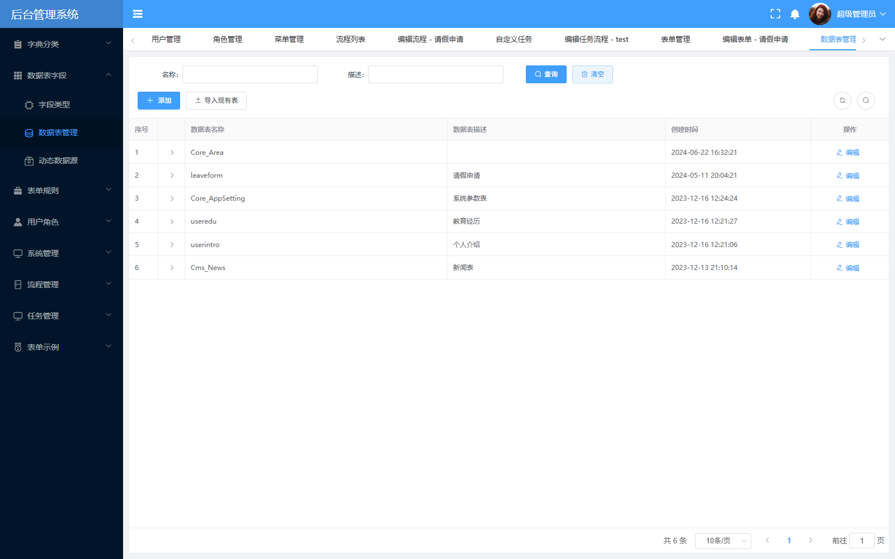

## 快速开始

### 环境要求
- .NET 8.0 SDK
- Node.js 14+
- SQL Server
- Redis (可选)

### 后端启动
1. 打开 `Nct.sln` 解决方案
2. 设置 `CoreModule.Host` 为启动项目
3. 运行项目

首次启动前，将对应宿主目录中的 `appsettings.example.json` 复制为 `appsettings.json`，填写数据库连接密码及 JWT 签名密钥。`Nct.Web` 也提供独立的配置示例；涉及多个宿主时需使用一致的 JWT 配置，并按部署地址调整 `ClientProxy`。

实际配置、`pwd.txt`、本地数据库文件和运行时上传文件均已通过 `.gitignore` 排除，不随源码提交。数据库结构及初始化数据需在运行环境中另行准备。

### 前端启动
1. 进入 `src/Nct.UI` 目录
2. 安装依赖: `npm install`
3. 启动开发服务器: `npm run serve`

## 模块开发

### 创建新模块
1. 在 `src/Modules` 目录下创建新的模块文件夹
2. 创建模块核心项目和契约项目
3. 实现 `BaseModule` 抽象类
4. 在宿主服务中注册模块

### 模块依赖
- 在模块的 `PreInitialize` 方法中添加依赖模块
- 通过 `[DependsOn]` 特性声明模块依赖

## 配置

### 应用配置
- 宿主服务的 `appsettings.json` 文件
- 支持环境变量配置

### 数据库配置
- 在 `appsettings.json` 中配置数据库连接字符串
- 支持多种数据库类型

### 缓存配置
- 在 `appsettings.json` 中配置 Redis 连接

## 部署

### 后端部署
- 发布宿主服务到 IIS 或 Docker
- 配置环境变量

### 前端部署
- 构建前端项目: `npm run build`
- 将构建产物部署到静态文件服务器

## 监控与日志

### 日志系统
- 基于 NLog 的日志记录
- 支持多目标输出

### 健康检查
- 内置健康检查端点
- 支持自定义健康检查

## 安全

### 认证与授权
- JWT 令牌验证
- 基于角色的访问控制

### 数据加密
- AES 加密实现
- 敏感数据保护

## 示例代码

### 创建模块

```csharp
public class MyModule : BaseModule
{
    public override void PreInitialize()
    {
        // 模块初始化前的配置
    }

    public override void Initialize()
    {
        // 模块初始化
        IocManager.RegisterAssemblyByConvention(Assembly.GetExecutingAssembly());
    }
}
```

### 创建服务

```csharp
public class MyAppService : CrudAppService<MyEntity, MyDto>
{
    public MyAppService(IRepository<MyEntity> repository) : base(repository)
    {
    }
}
```

## 总结

Nct-MicroService 是一个功能完整、架构清晰的微服务框架，提供了企业级应用开发所需的各种功能。它采用模块化设计，支持插件式扩展，便于开发者快速构建和部署复杂的业务应用。

## 许可证

MIT License

## 联系方式

如有问题或建议，请联系项目维护者。
